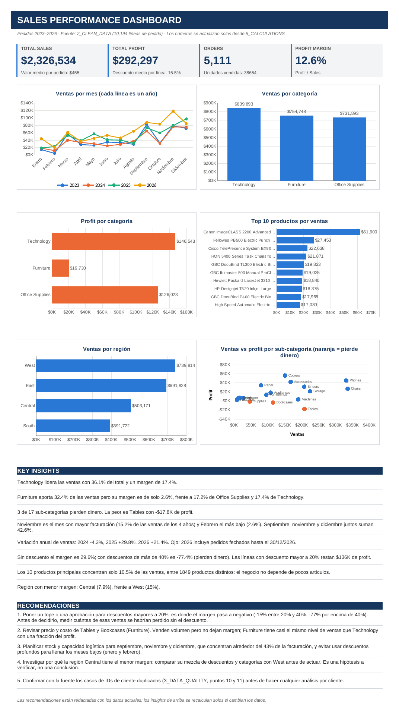
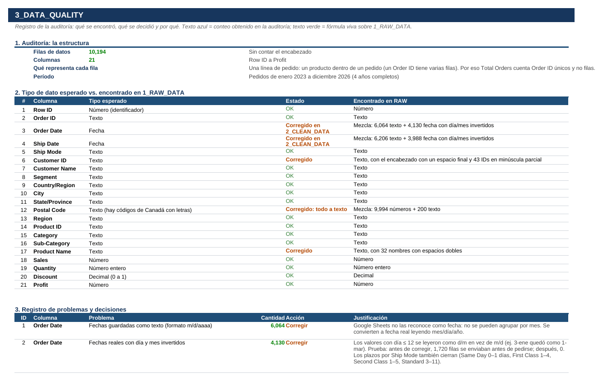
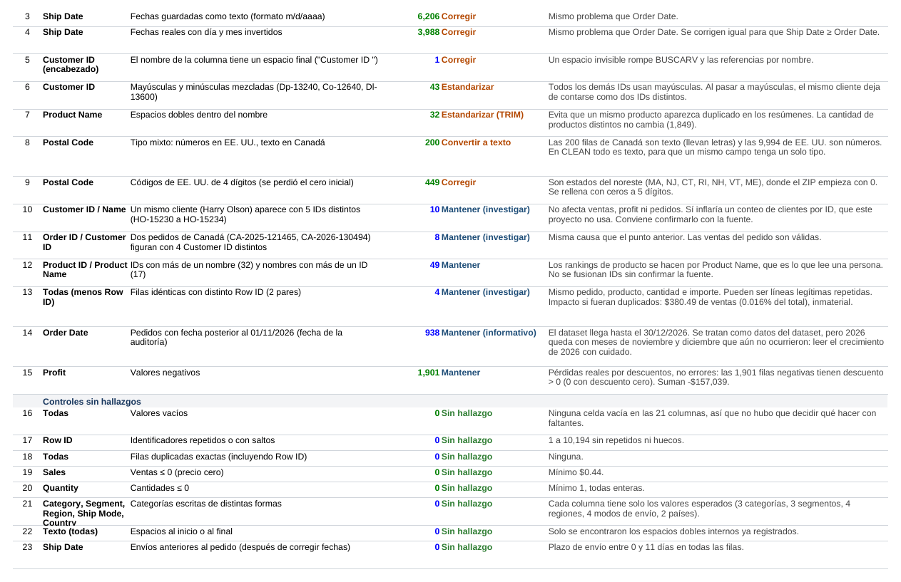
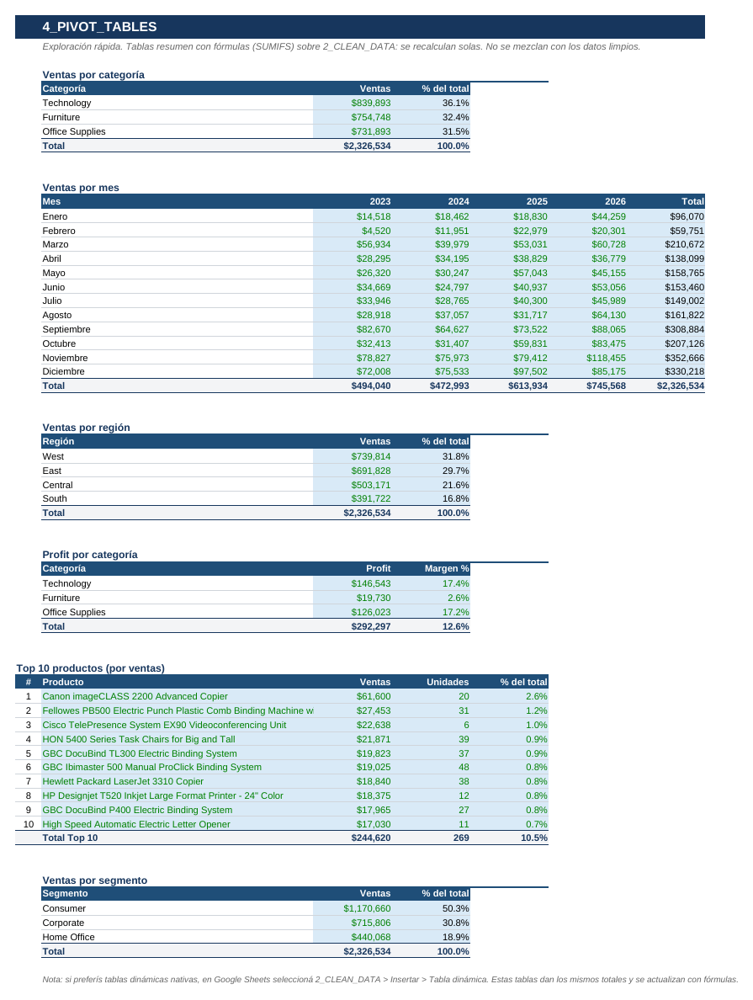
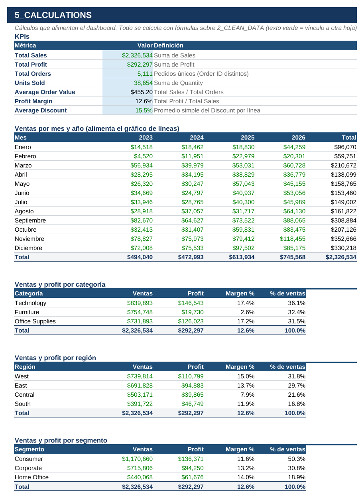

# 🛒 Superstore USA — Limpieza de datos y Dashboard de Ventas 2023–2026

[](datos/Sales_Dashboard_Project.xlsx)

Proyecto de análisis de datos en hojas de cálculo: se parte de un dataset comercial con errores reales (fechas rotas, IDs inconsistentes, códigos postales incompletos), se limpia con un registro de cada decisión y se construye un dashboard con KPIs, gráficos e insights de negocio.

---

## 🎯 Objetivo

Convertir un dataset de 10.194 líneas de pedido en información útil para decidir: qué categorías, regiones y productos generan ventas y, sobre todo, cuáles dejan ganancia real.

## 🧹 Limpieza de datos

Antes de analizar, audité los datos y encontré problemas que cambian los resultados si no se corrigen:

- **Fechas:** 6.064 fechas de pedido guardadas como texto y 4.130 con el día y el mes invertidos. Sin corregirlas, **1.720 pedidos figuraban como enviados antes de ser pedidos**; después de corregirlas, ninguno.
- **IDs de cliente:** 43 con mayúsculas y minúsculas mezcladas (`Dp-13240` → `DP-13240`).
- **Nombres de producto:** 32 con espacios dobles.
- **Códigos postales:** 449 de EE. UU. sin el cero inicial (`6824` → `06824`).
- **Sin hallazgos:** no hay celdas vacías, precios ni cantidades en cero, ni categorías escritas de distintas formas. Se documentó igual, porque descartar también es parte de la auditoría.

No se eliminó ninguna fila y una conciliación entre datos originales y limpios confirma que ventas, profit y cantidades no cambiaron. Cada decisión (corregir, estandarizar o mantener) está justificada en la hoja `3_DATA_QUALITY`.

## 🔍 Preguntas de negocio

- ¿Qué categorías y sub-categorías son rentables y cuáles pierden dinero?
- ¿Qué efecto tienen los descuentos en el margen?
- ¿Hay estacionalidad en las ventas?
- ¿Qué regiones y segmentos rinden mejor?
- ¿Las ventas dependen de unos pocos productos?

## 📈 Principales hallazgos

- **$2,33 M** en ventas, **$292 K** de profit y un margen del **12,6 %**, sobre 5.111 pedidos.
- **Furniture** aporta el 32,4 % de las ventas pero solo un **2,6 %** de margen, frente a 17 % de Technology y de Office Supplies. **Tables** y **Bookcases** pierden dinero.
- **Los descuentos son el factor que más pesa:** sin descuento el margen es **29,6 %**; con descuentos de más de 40 % es **−77,4 %**. Las líneas con descuento mayor a 20 % restan $136 K de profit.
- **Noviembre** es el mes de mayor facturación (15,2 % de las ventas de los 4 años); septiembre, noviembre y diciembre suman el 42,6 %.
- La región **Central** tiene el menor margen (7,9 %) frente a West (15 %).
- Los 10 productos principales concentran solo el 10,5 % de las ventas: el negocio no depende de pocos artículos.

## 🖼️ Dashboard



<details>
<summary>Ver más capturas</summary>

**Registro de calidad de datos**




**Tablas resumen**



**Cálculos y KPIs**



</details>

## 🛠️ Herramientas y técnicas

- **Google Sheets / Excel:** entorno de todo el proyecto, en un solo archivo con 6 hojas.
- **Limpieza:** `TRIM`, `UPPER`, `DATE`, `YEAR`, `MONTH`, conversión de texto a fecha, relleno de ceros en códigos postales y detección de inconsistencias con `SUMPRODUCT`, `EXACT` y `COUNTIF`.
- **Análisis:** `SUMIFS`, `INDEX` + `MATCH`, `LARGE` para el Top 10 y tablas por categoría, mes, región y segmento.
- **Visualización:** 6 gráficos (líneas, columnas, barras, dispersión) y tarjetas de KPIs.
- **Insights dinámicos:** frases del dashboard armadas con fórmulas, que se recalculan si cambian los datos.

## 📐 Fórmulas destacadas

```text
Total Orders   = SUM(Order Flag)                                  → pedidos únicos
Order Flag     = IF(MATCH(OrderID, Rango, 0) = ROW()-1, 1, 0)     → 1 solo en la primera línea de cada pedido
Profit Margin  = Total Profit / Total Sales
Top 10         = LARGE(Ventas por producto, k) + INDEX/MATCH
Fecha corregida (día/mes invertidos) → se intercambian y se verifica que Ship Date ≥ Order Date
```

## 📁 Estructura del proyecto

```text
Proyecto_Superstore_Dashboard/
├── README.md
├── datos/
│   └── Sales_Dashboard_Project.xlsx   # el proyecto completo, con 6 hojas
└── imagenes/                          # capturas usadas en este README
```

Hojas del archivo Excel:

```text
1_RAW_DATA        # dataset original, sin tocar
2_CLEAN_DATA      # datos limpios (10.194 filas)
3_DATA_QUALITY    # auditoría, decisiones, antes/después y conciliación
4_PIVOT_TABLES    # tablas resumen para la exploración
5_CALCULATIONS    # KPIs y tablas que alimentan los gráficos
6_DASHBOARD       # KPIs, gráficos, insights y recomendaciones
```

## 👤 Autor

**Fernando Javier Acosta** — Proyecto de portfolio en análisis de datos

- LinkedIn: _agregá tu enlace aquí_
- Email: _agregá tu correo aquí_
